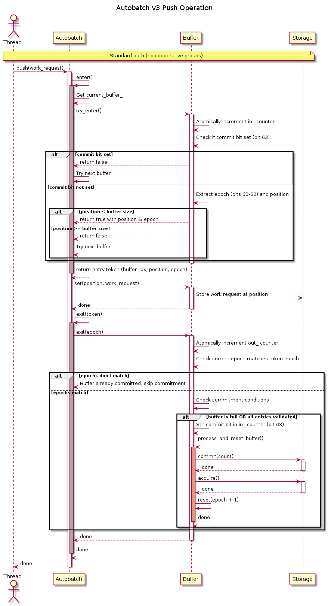
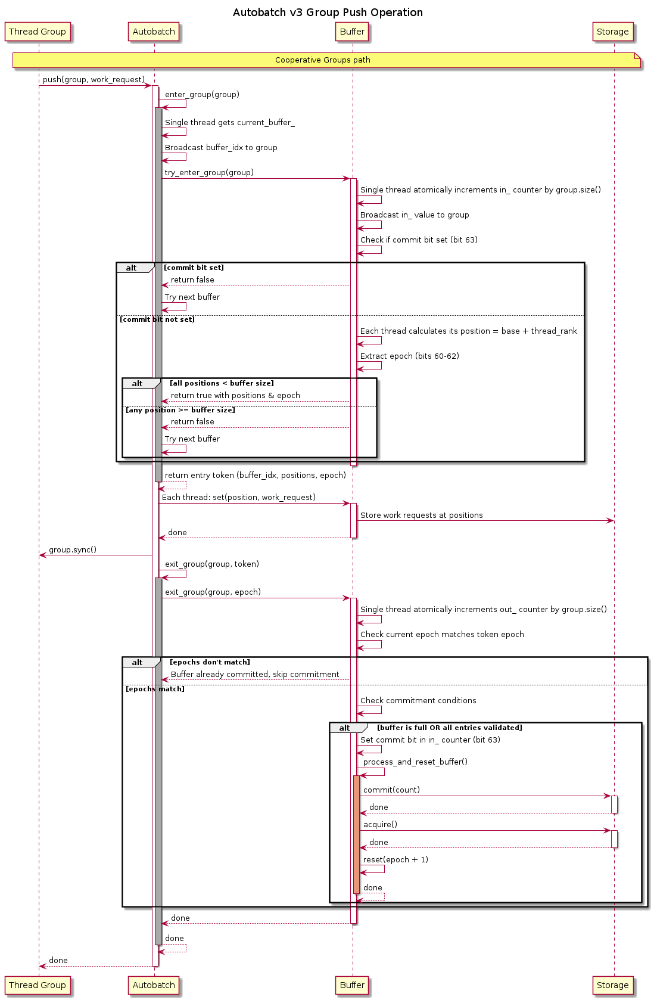
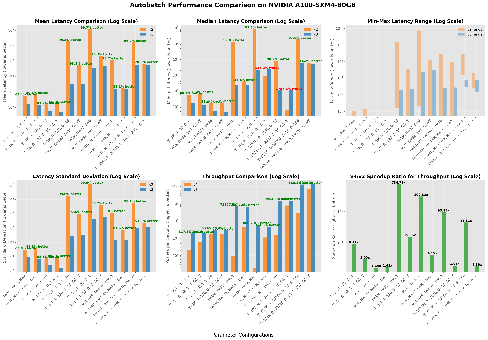
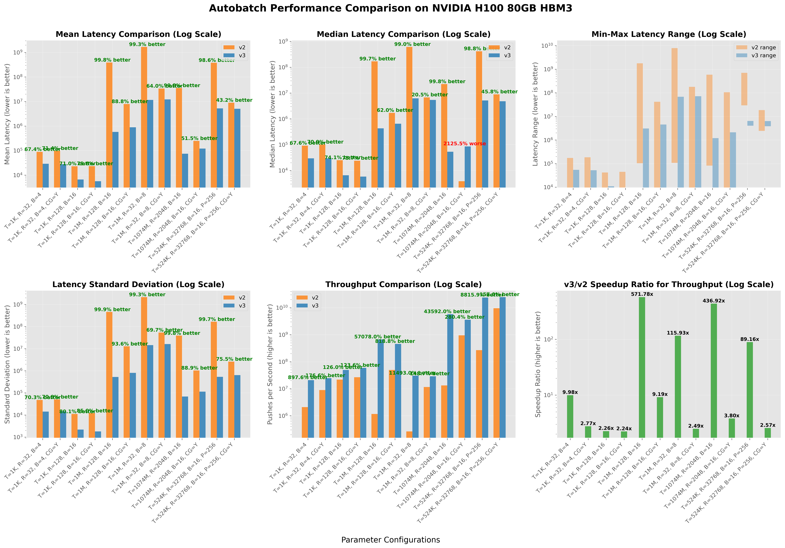
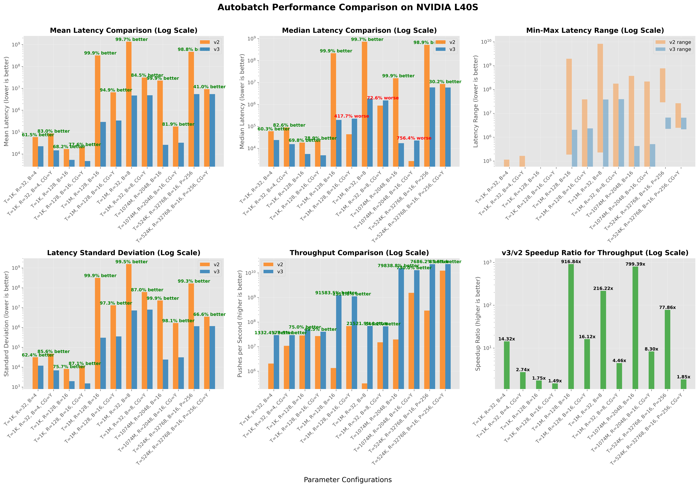

.. SPDX-FileCopyrightText: Copyright (c) 2026 NVIDIA CORPORATION & AFFILIATES. All rights reserved.
.. SPDX-License-Identifier: Apache-2.0

===================================================
GPU Direct Access Kernel Storage -- Autobatch v3
===================================================

Autobatch is the high throughput work submission mechanism used in GDAKIS.
An autobatch includes a collection of work request buffers, each composed of a batch of
work requests, and a control mechanism that tracks which buffer new work requests should 
attempt to use.
This design enables forming and submitting multiple work request entry batches concurrently.
Using multiple buffers concurrently and auto-advancing among buffers with arithmetic means are a 
key part of the automation in autobatch that yields performance.

Data Structures
---------------

The autobatch v3 control includes 

1. a buffer array - user-defined size, power of 2. More buffers may help downstream concurrency. 
   More buffers may be needed to tolerate latency to storage, since submitted buffers do not become 
   available again until all of their requests complete with notification. 
2. a counter, ``current_buffer_``, which indicates the preferred initial buffer 
   to try for submission. While trying other buffers,``current_buffer_`` does not get incremented.

Each work request buffer includes a collection of work request entries laid out contiguously in
the virtual address space, two atomic counters, ``buffer.in_`` and ``buffer.out_``, and an atomic
group-close record, ``buffer.close_at_``.
The ``buffer.in_`` counter is a 64-bit, atomically-accessed value that tracks:

- The buffer's epoch in bits 56-62 (7 bits)
- The commit bit in bit 63
- The number of entries allocated (or attempted to be allocated) within the buffer in the lower bits

The code that increments the buffer's epoch must check for overflow.
The likelihood that the number of entries in the buffer will reach 2^56 is vanishingly small.
The ``buffer.out_`` counter tracks only the number of entries with valid contents within the buffer.
The ``buffer.close_at_`` record uses the same epoch and position layout as ``buffer.in_``. Its high
bit indicates whether a published group-close boundary has already been claimed.

A critical difference from v2 is that the ``out_`` counter is only incremented when entries are validated, rather than tracking all entry acquisitions.

Buffer Selection
----------------

Autobatch v3 uses a simpler approach to buffer selection compared to previous versions:

1. When entering the autobatch, a thread starts with the buffer indicated by ``current_buffer_``
2. The thread attempts to acquire a position in the buffer using ``try_enter()``
3. If unsuccessful, the thread tries the next buffer in sequence
4. If all buffers are tried without success, it employs a backoff strategy with increasing delay and retries

This approach allows threads to naturally distribute across available buffers, reducing contention on any single buffer.

Unlike v2, which had complex logic for selection and fallback of active buffers, v3 simply tries different buffers sequentially until one succeeds.

Acquiring a Work Request Entry
------------------------------

Buffer entry acquisition is the process by which a thread gets a reference to a work request entry in a buffer. 
The process is as follows:

1. On the CPU, the thread atomically increments the buffer's ``in_`` counter using
   ``fetch_add(1)``. On the GPU, active lanes targeting the same buffer form a coalesced subgroup;
   one lane performs ``fetch_add(group_size)`` and broadcasts the returned base position.
2. The returned value is checked to see if the commit bit is set.
3. If the commit bit is set, the acquisition fails because the buffer epoch is closed.
4. If the commit bit is not set, each thread extracts:

   - The current epoch from bits 56-62 and saves it for later comparison
   - The position within the buffer from the lower bits; GPU lanes add their
     ``thread_rank()`` within the coalesced subgroup to the broadcast base

5. If the position is within the buffer's capacity, the acquisition succeeds.

Exactly one thread can succeed in step 5 for a given entry, by construction, therefore the act of 
acquiring any given entry must be mutually exclusive.

A key distinction from v2 is that in v3, only the ``in_`` counter is incremented during acquisition, 
while the ``out_`` counter is incremented during validation. In v2, both ``in`` and ``out`` counters were 
incremented during the acquisition phase, regardless of whether that acquisition ultimately succeeded.

An explicit cooperative-group reservation is indivisible. If all of its positions fit, every lane
succeeds. If it straddles the buffer capacity, every lane fails and the first such group publishes
its starting position in ``close_at_``, then sets the commit bit in ``in_``. That release operation
publishes the close record and freezes the epoch against successful reservations. Reservations
racing with or following the close may continue to increment ``in_``, but cannot succeed in that
buffer epoch.

Validating a Work Request Entry
-------------------------------

Upon successfully acquiring a work request entry, the thread fills its contents.
Once the contents of the entry contain the desired values, the thread proceeds to validate the entry by calling 
``exit()`` with the entry token.

The validation process:

1. Increments the buffer's ``out_`` counter, indicating a valid entry ready for submission
2. Checks if conditions for buffer commitment are met
3. Potentially triggers buffer commitment. Only the N threads which get a valid entry will atomically 
   increase ``out_``, a total of N times.

The epoch system ensures that threads cannot commit a buffer that has already been committed by checking 
if the current epoch matches the epoch when the entry was acquired. If the epochs don't match, it means 
the buffer has been reset and committed, and the thread should not proceed with commitment. 
Exactly one thread at a time can meet the conditions of setting the commit bit, by construction.

Work Request Buffer Commit
--------------------------

A buffer is ready for commitment when either:

1. All allocated positions have been validated (``in_`` = ``out_`` excluding epoch and commit bits, and neither is zero), or
2. The buffer is full (``out_`` = buffer size), or
3. ``out_`` reaches the current epoch's unclaimed ``close_at_`` boundary.

The third condition covers an indivisible cooperative group which crossed the capacity. Every
reservation before ``close_at_`` fitted completely, so the valid entries form the contiguous prefix
``[0, close_at_)``. Either the group which publishes the boundary or the last exiting valid entry
may claim it. An exit observes the published record after acquiring the commit bit from ``in_``.
Only the successful claimant commits and resets the buffer.

The closer and the last valid exit also form a handoff through ``out_``. The closer performs a release
zero-add RMW after publishing the close record. If the last exit precedes that RMW, the closer observes
the completed count and finalizes. If the last exit follows it but initially reads a stale ``in_``
value, it acquires the ``out_`` release sequence and re-reads ``in_`` before returning. This slow-path
recheck prevents both actors from missing finalization without adding acquire semantics to every
producer's completion RMW.

When these conditions are met, the buffer's commit process:

1. Sets the commit bit in the ``in_`` counter to prevent further entry acquisitions. A group-close
   publisher performs this step immediately after writing ``close_at_``.
2. Processes and resets the buffer:

   a. Submits valid entries within a buffer as a batch
   b. Waits for the operation to complete
   c. Resets the buffer counters for reuse
   d. Increments the epoch counter (stored in bits 56-62)

The reset does not modify ``close_at_``. The claimed record is left with its previous epoch, so it
cannot close the next buffer epoch. A later straddling group replaces it with a new unclaimed record.

Unlike v2, which relied on complex epoch tracking and coordination, v3 uses a simpler commit mechanism that operates at the buffer level.

Push Operation Sequence
-----------------------

The following diagram illustrates the standard push operation sequence in autobatch v3:

   Figure 1: Sequence diagram of a standard push operation in autobatch v3

For cooperative groups, the sequence is as follows:

   Figure 2: Sequence diagram of a cooperative groups push operation in autobatch v3

Cooperative Groups Support
--------------------------

Autobatch v3 maintains support for CUDA Cooperative Groups while significantly improving the performance of the 
non-cooperative path. 
Unlike v2, where using cooperative groups was practically mandatory for good performance, v3 makes it truly optional.
Calls to non-CG functions will indeed end up using CG under the hood.

The cooperative groups implementation:

1. ``enter_group()``: A single thread obtains the current buffer and the group collectively acquires consecutive positions.
   The reservation succeeds for every lane or fails for every lane.
2. ``exit_group()``: The group ensures all threads have completed their work, and a single thread performs the exit for the 
   entire group
3. ``push()`` with group support: A convenience method that handles the entire cycle for the group

Invariants and Conditions
-------------------------

Key Invariants
~~~~~~~~~~~~~~

1. ``out_`` ≤ ``in_`` (excluding epoch and commit bits) in all valid states
2. The ``in_`` counter is always incremented during ``try_enter()``, even when it fails
3. The ``out_`` counter is incremented only after entries have been successfully validated
4. The per-buffer epoch bits (56-62) are only modified during buffer reset.
   Multiple bits are used to cover the case where a thread wakes up and notices that the commit
   requirements have been met, but the buffer is already committed. Exceeding 2^7=128 times is
   assumed to be very unlikely, but this is a potential source of fragility, since the 
   commit bit could get overwritten.
5. The commit bit (63) closes the current epoch to successful acquisitions. It is set either when
   commitment starts or after the first straddling group publishes ``close_at_``; the latter closes
   the epoch before its valid prefix is ready to be committed and reset.
6. An unclaimed ``close_at_`` belongs to one epoch and identifies the end of its contiguous valid prefix
7. ``close_at_`` is not reset to the next epoch; it remains claimed until another straddling group publishes it

Preconditions
~~~~~~~~~~~~~	

1. ``try_enter()``: None (will try regardless of buffer state)
2. ``exit()``: Entry token was obtained from a successful ``enter()``, and entry has been filled
3. ``buffer.reset()``: Buffer has been committed and processed
4. ``enter_group()``: The group size does not exceed the capacity of at least one autobatch buffer

Postconditions
~~~~~~~~~~~~~~

1. ``try_enter()``: If successful, returns position within buffer capacity and current epoch. ``in_`` counter for the selected buffer is always incremented.
2. ``exit()``: Entry is marked as valid, buffer may be committed if conditions are met
3. ``buffer.reset()``: Buffer counters are reset, new epoch is set, buffer is available for reuse

Performance Characteristics
---------------------------

The v3 design offers several key performance advantages:

1. **Reduced Contention**: By trying multiple buffers in sequence, threads distribute more evenly rather than contending for a single active buffer.

2. **Optimized Validation**: The ``out_`` counter only tracks valid entries, reducing unnecessary atomic operations.

3. **Simplified Buffer Management**: Direct buffer selection replaces complex epoch advancement, reducing coordination overhead.

4. **Balanced Threading Model**: Performs well with both individual thread submissions and cooperative groups, providing flexibility based on use case.

5. **Efficient Epoch System**: The epoch bits in the ``in_`` counter provide a lightweight mechanism to prevent race conditions during buffer commitment without requiring additional synchronization.

A100 GPU Performance Analysis
-----------------------------

The following chart presents a detailed breakdown of autobatch v3 performance compared to v2 on NVIDIA A100-SXM4-80GB GPUs:

   Figure 6: Detailed performance metrics comparing autobatch v2 and v3 on NVIDIA A100 GPU

The benchmarks on A100 show even more dramatic improvements than other GPUs:

1. **Exceptional Throughput Scaling**: In the most extreme configurations (1B+ threads), v3 achieves over 50x throughput improvement compared to v2.

2. **Consistent Latency Reduction**: Mean latency is reduced by 67-99% across all test configurations, with particularly large improvements in high-thread scenarios.

3. **Improved Predictability**: The standard deviation is significantly reduced in v3, indicating more consistent performance and less performance variability.

4. **Cooperative Groups Performance**: On A100, both v2 and v3 show roughly equivalent performance benefits from cooperative groups (about 0.7% improvement in v3), but v3 already performs so well without them that they become optional rather than necessary.

Key observations from the above benchmarks:

1. **Scalability with Thread Count**: v3 maintains excellent performance even at very high thread counts (>1 billion), where v2 significantly degrades.

2. **Reduced System Time**: The system time required for operations is drastically reduced in v3, particularly for large-scale workloads.

3. **Consistency Across GPUs**: While absolute performance varies by GPU, the relative advantage of v3 is consistent across hardware, suggesting that the architectural improvements are universally beneficial.

4. **Large Buffer Support**: Configurations with large request counts and buffer sizes see exceptional improvements, highlighting v3's efficient buffer management.

These results validate that autobatch v3's redesigned architecture delivers superior performance across a wide range of workloads and hardware configurations.

Multi-GPU Performance Comparison
--------------------------------

The performance improvements of autobatch v3 are consistent across different NVIDIA GPU architectures, as shown in the following comparisons:

   Figure 7: Performance comparison on NVIDIA H100-80GB GPU

   Figure 8: Performance comparison on NVIDIA L40S GPU

Key observations across GPU architectures:

1. **Universal Performance Gains**: The performance improvements of v3 are consistent across different GPU architectures, 
   from high-end data center GPUs (A100, H100) to workstation GPUs (L40S).

2. **Scalability**: All GPUs show similar scaling patterns, with v3 maintaining high performance even at extreme thread 
   counts where v2 degrades significantly.

These results across multiple GPU generations validate that autobatch v3's architectural improvements deliver superior performance consistently, 
making it an ideal choice for high-throughput, low-latency applications running on modern NVIDIA GPUs.

Buffer States
~~~~~~~~~~~~~

Buffers are always in one of the following states:

1. Reset. Upon some thread attempting ``try_enter()``, transition to Filling
2. Filling: open to new entries

   a. Upon meeting the condition ``in_`` >= buffer size, transition the active buffer to Completing because no thread can add an entry since ``try_enter()`` will always fail.
   b. Upon meeting the conditions for commitment in ``exit()``, transition to Committed

3. Completing: not open to new entries, but not all validated and committed yet

   a. Upon meeting the conditions for commitment in ``exit()``, transition to Committed

4. Committed. Waits for all IO requests in the buffer's batch to complete, then perf ``reset()`` and transition to Reset state.

There is no meaningful distinction between Filling and Full.

Thread States
~~~~~~~~~~~~~

Threads are always in one of the following states:

1. In ``try_enter()``

   Multiple threads can be in ``try_enter()`` at a time.
   No thread can succeed in ``try_enter()`` if the current buffer has its commit bit set, due to an atomic check.
   Multiple of them could try incrementing ``in_`` at the same time.
   Multiple of them could exceed buffer size upon incrementing ``in_`` at the same time.
   No thread can succeed in ``try_enter()`` if the position matches or exceeds the maximum buffer size,
   due to an atomic check; it would move on to try another buffer.
   Multiple of them could try to update ``active_buffer_`` at the same time.
   Only one thread can acquire a given entry in any particular buffer in ``try_enter()``.

2. Filling an entry

3. In ``exit()``, which is executed only after ``try_enter()`` succeeds

   Multiple threads can be in ``exit()`` at a time.
   Multiple of them could try incrementing ``out_`` at the same time.
   No more than one thread can obtain an ``out_`` == ``max_size_`` and that thread commits the buffer.
   This is because ``out_`` is atomically incremented and ``max_size_`` is a constant.
   It's also possible that no thread reaches ``out_`` == ``max_size_`` because of insufficient threads, 
   and exactly one thread will obtain ``out_`` == ``in_`` within a given epoch, such that it can commit.
   Before committing, multiple threads can think that they have an ``out_`` = ``in_``, but either
   ``out_`` or especially ``in_`` may have changed while sleeping. To handle this case, we then check that
   ``out_`` and ``in_`` match and that we're in the saved epoch.
   An epoch alias is possible from epoch wraparound. See separate documentation on the autobatch 
   failure condition.
   It is also possible that while setting the commit bit, the ``in_`` value which was previously read
   and which is written has since been incremented, such that the value of ``in_`` could regress.
   But this does not matter for the case where the commit bit is set, only for cases where commit is not set.
 
4. Executing some other code.
